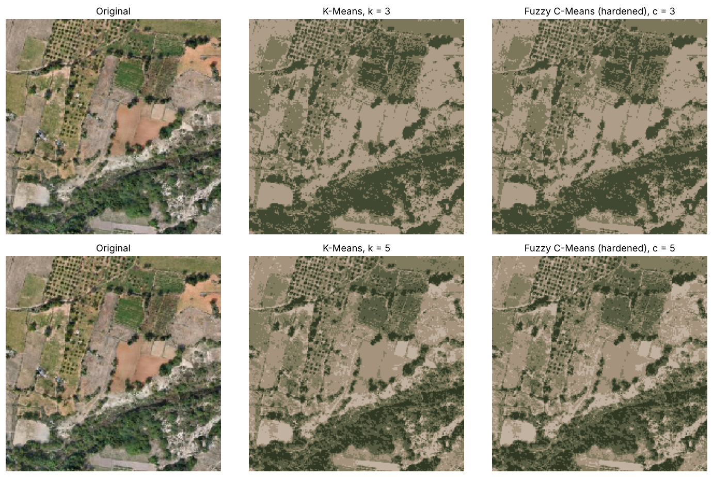
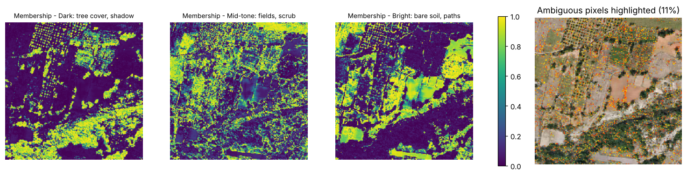

# Aerial Image Segmentation: Fuzzy C-Means vs K-Means

Colour-based land-cover segmentation of an aerial photograph. Hard clustering (K-Means) is compared with soft clustering (Fuzzy C-Means), and the question is what fuzzy memberships add beyond a segmentation map.

  

## Key results (40,000 pixels)

| | c = 3 | c = 5 |
|---|---|---|
| Hard-label agreement, K-Means vs FCM | 99.25% (299 pixels differ) | 97.7% (916 pixels differ) |
| FCM partition coefficient (m = 2) | 0.745 | 0.657 |
| Ambiguous pixels (max membership < 0.6) | 10.9% | – |

| Fuzzifier m | 1.25 | 1.5 | 2.0 | 2.5 | 3.0 |
|---|---|---|---|---|---|
| Partition coefficient | 0.951 | 0.893 | 0.745 | 0.615 | 0.526 |
| Ambiguous pixels | 2.0% | 4.3% | 10.9% | 20.7% | 34.7% |
| Agreement with K-Means | 99.5% | 99.4% | 99.3% | 99.0% | 98.6% |

**Findings**

1. **Hard segmentations are practically identical.** If all you need is a segmentation map, K-Means is sufficient.
2. **FCM's value is the uncertainty map.** About 11% of pixels have no dominant class. They lie along field edges, orchard rows and scrub-to-bare-ground transitions, and they are exactly where the two methods disagree: mean max-membership is 0.49 there, against 0.83 elsewhere.
3. **The fuzzifier *m* sets how many pixels are flagged as ambiguous (2–35%)** without changing the segmentation, which makes it a direct dial for how much review work to generate.

<p align="center">
  <br>
  
</p>

## Approach

1. Reshape the image to 40,000 RGB points.
2. Choose the number of clusters using K-Means inertia, the silhouette score (5,000-pixel sample) and the FCM partition coefficient.
3. Segment with K-Means and FCM at c = 3 and c = 5. FCM labels are aligned to K-Means labels by Hungarian matching before comparing.
4. Map memberships and highlight ambiguous pixels (max membership < 0.6).
5. Sweep the fuzzifier m from 1.25 to 3.0.

## Repository structure

```
image-segmentation-fuzzy-c-means/
├── data/aerial_img.png
├── notebooks/fuzzy_c_means_image_segmentation.ipynb
├── outputs/figures/   outputs/metrics/
├── reports/Fuzzy_C_Means_Image_Segmentation_Report.docx
├── requirements.txt   LICENSE   README.md
```

## How to run

```bash
git clone https://github.com/kashiprasadtn/image-segmentation-fuzzy-c-means.git
cd image-segmentation-fuzzy-c-means
python -m venv .venv && source .venv/bin/activate   # Windows: .venv\Scripts\activate
pip install -r requirements.txt
jupyter lab notebooks/fuzzy_c_means_image_segmentation.ipynb
```

Run all cells (under a minute). Seeds are fixed (`random_state = 42`).

## Limitations

- Colour only: no texture or spatial context, so shadows and dark vegetation fall in the same class.
- No ground-truth land-cover labels, so accuracy cannot be measured, only agreement and uncertainty.
- A single 200 × 200 image.

## Data and attribution

- **Image:** `aerial_img.png` was supplied through upGrad coursework for educational use; its original source is not documented.
- The analysis is my own implementation and extends an upGrad Fuzzy C-Means demo, which is not reproduced here. Fuzzy C-Means uses [scikit-fuzzy](https://github.com/scikit-fuzzy/scikit-fuzzy).
- Completed as part of the MS in Artificial Intelligence (Liverpool John Moores University, delivered via upGrad).

## Licence

Code is released under the [MIT License](LICENSE). The image is excluded.
